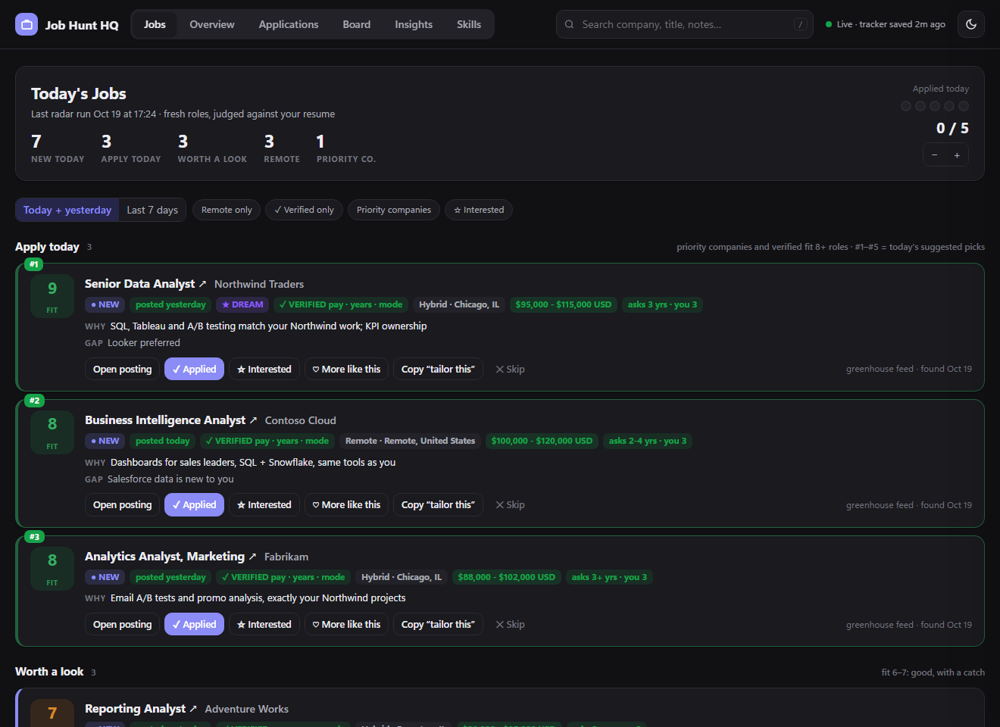
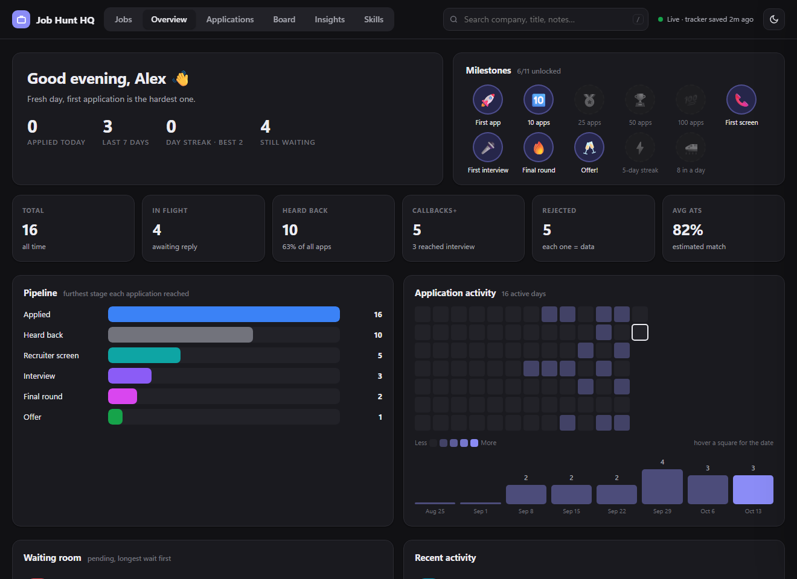
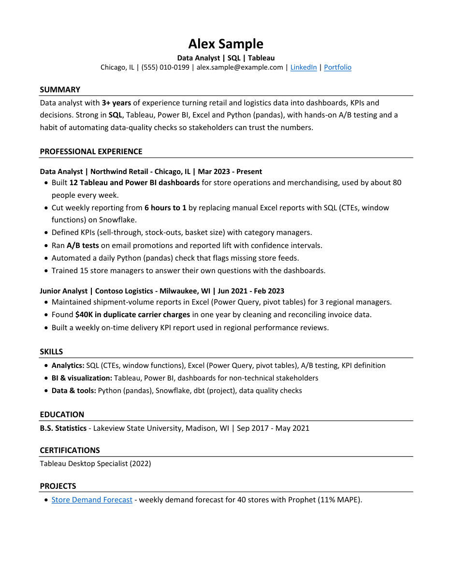
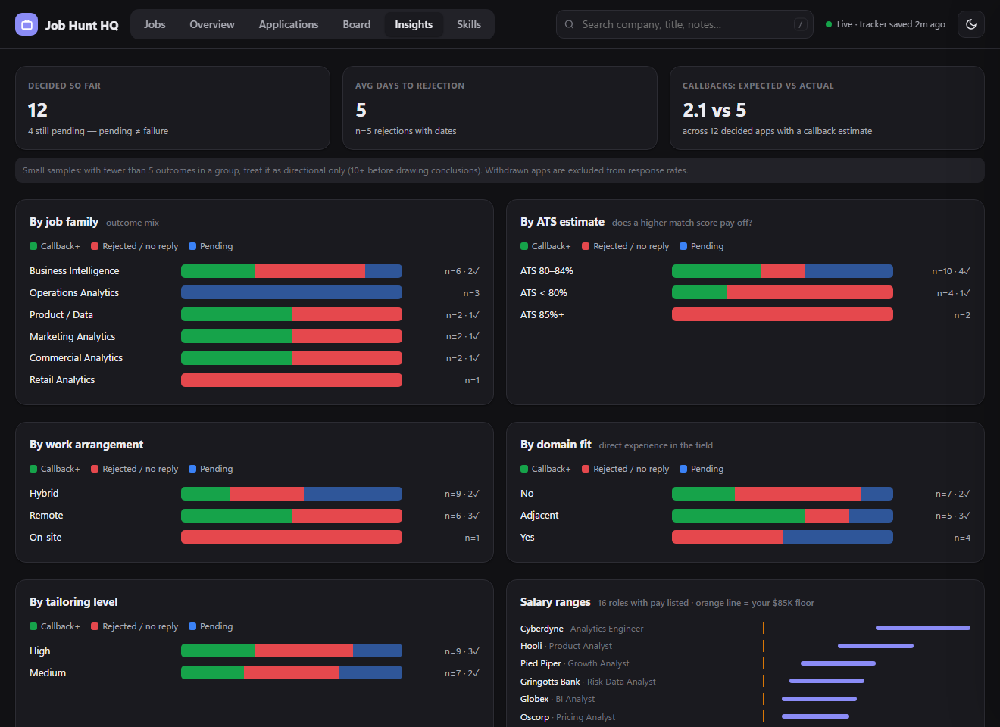
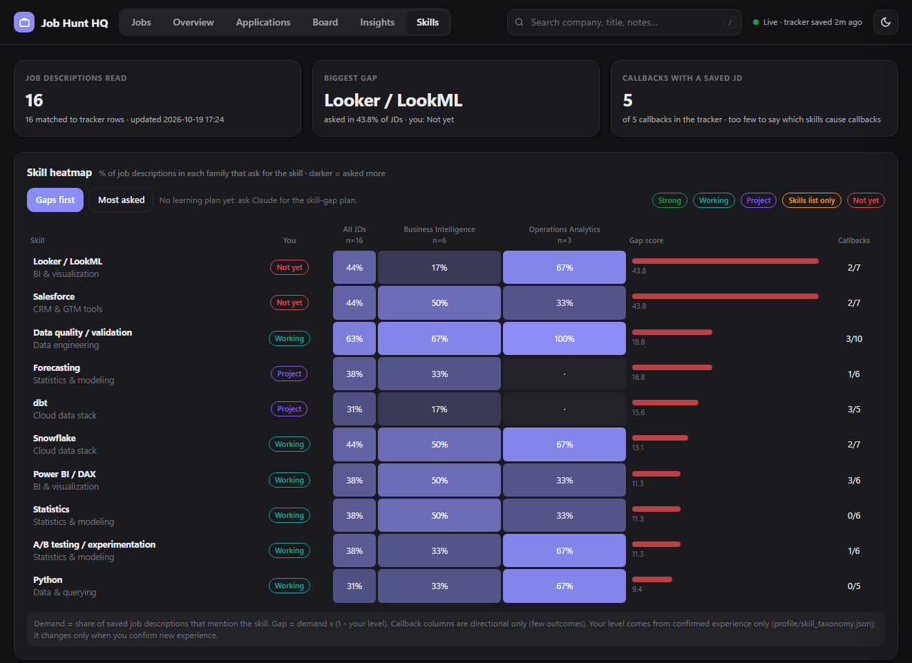

# Job Hunt HQ

**An AI job-search system that runs inside Claude Code.** It tailors your resume to each job without
inventing anything, measures how an ATS reads it, writes the cover letter, finds fresh postings every
day, and tracks every application on a private dashboard on your own computer.

> Paste a job link. Get a tailored resume, a cover letter and an honest match score in a few minutes.



<table><tr>
<td></td>
<td></td>
</tr><tr>
<td></td>
<td></td>
</tr></table>

<sub>All screenshots use a fictional person, Alex Sample. After installing, ask Claude "show me the Job Hunt HQ demo" to click around it yourself.</sub>

## What it does

| | |
|---|---|
| **Truthful tailoring** | Rewrites your resume in each job's language using only facts you've confirmed. It asks about real gaps instead of making things up, and never changes employers, titles, dates or numbers. |
| **Measured ATS check** | Reads your PDF the way applicant tracking systems do (two parsers), checks your contact details and headings survive, and scores keyword coverage: which required terms are in your experience, which are only in Skills, which are missing. |
| **Full application package** | Resume and cover letter as Word and PDF, plus the original posting saved verbatim, in one folder per job. Automatic checks for page fill, broken links, bold overuse, clichés and dashes in letters. |
| **Daily job radar** | Watches the job boards of companies you pick (or companies Claude finds for you) on Greenhouse, Lever, Ashby, Workday, SmartRecruiters and more. Keeps only fresh roles that match your titles, locations, work mode, pay floor and experience, then scores each one against your background. |
| **Local dashboard** | Today's best jobs with one-click Applied / Interested / Skip, your pipeline, streaks, a waiting room with follow-up nudges, a kanban board, insights on what's working, and a skill-gap heatmap. Runs only on `127.0.0.1`. |
| **Tracker that stays honest** | One Excel workbook. Estimates are recorded when you apply and never rewritten, so you can compare expected and actual results. Backups on every change. |
| **Interview prep** | A prep pack per interview stage: likely questions, your matching STAR stories, honest answers for your gaps, research on the company, and questions to ask. Mock interviews on request. |
| **Skill gaps** | A heatmap of what your saved job descriptions ask for vs. what you can truthfully claim, and a learning plan with small proof projects. |

Optional: with Claude's Gmail connector it notices rejections and interview invites and updates your
tracker; with the Indeed or Dice connectors the radar also searches those boards.

## A day with Job Hunt HQ

1. **It finds the jobs for you.** At the time you choose during setup (say 5 PM on weekdays), the radar
   runs on its own. It checks the job boards of every company you watch, keeps roles posted in the last
   day or two that match your titles, places, work mode, pay floor and years of experience, and scores
   each one against your real background.
2. **Your shortlist is waiting on the dashboard.** Open it and the Jobs tab shows today's best roles
   first, each with why it fits, any gaps, the pay and the years asked. Your daily goal (for example
   5 applications) is shown as dots you fill in.
3. **One click to tailor.** Press **Copy "tailor this"** on a job and paste it into Claude Code. The
   copied text already holds the company, role, link and what to do, so Claude reads the full posting,
   shows your current match, asks only about real gaps, and builds your tailored resume, cover letter
   and a saved copy of the posting in a few minutes.
4. **You apply, it keeps the records.** Submit the application yourself, then click **Applied** on the
   dashboard. About a minute later the tracker has a new row, including the match scores of the exact
   resume you sent.
5. **Replies move it along.** Tell Claude "Acme rejected me" or "Globex wants an interview Thursday"
   (or let it read your Gmail, if you connected it), and the tracker and pipeline update. Ask "prep me
   for Globex" and you get an interview prep pack.

Your skips and likes on the dashboard (with one-click reasons like "too senior" or "low pay") feed into
how Claude scores new jobs, and an optional weekly review suggests changes: new companies to watch,
titles to drop, a different pay floor.

## How it works

You talk to Claude Code as usual. Three Claude skills handle the conversation (setup, applications,
job radar) and call small Python tools for everything that must be exact: building documents, the ATS
check, the tracker, the job feeds and the dashboard.

```
You: "Tailor my resume for this: https://jobs.ashbyhq.com/acme/..."
Claude: reads the posting, shows your current match, asks 2 questions about real gaps,
        builds the package, runs the checks, shows before/after scores.
You: "I applied."   ->  added to your tracker
You: "Acme invited me to an interview Thursday"  ->  tracker updated, prep pack built
```

## Install

You need [Claude Code](https://claude.com/claude-code) (desktop app or terminal), Python 3.9+, and
Microsoft Word **or** the free [LibreOffice](https://www.libreoffice.org/) for PDFs. Built for Windows,
macOS and Linux; tested so far on Windows. If something breaks on a Mac or Linux, please open an issue.

**Easiest:** open Claude Code and say:

> Install Job Hunt HQ from https://github.com/Prabhjot2s/job-hunt-hq and follow its INSTALL.md

Claude clones it, runs the installer, and then you start a new chat and say **"set up Job Hunt HQ"**
(new skills load in a new conversation).

**By hand:**
```bash
git clone https://github.com/Prabhjot2s/job-hunt-hq.git
cd job-hunt-hq
python install.py
```
(Use `python3` on macOS and Linux.) Then start a new Claude Code chat and say **"set up Job Hunt HQ"**.

The setup asks for your resume and a few preferences (about 15-25 minutes): what Claude may change on
your resume, the roles and places you want, your pay floor, the companies to watch (or Claude finds
them), and when the radar should run.

## Your data stays yours

- Everything lives in a folder **you** choose (for example `Documents/Job Hunt`), never inside this
  repo, so it can't be committed by accident.
- The dashboard listens only on `127.0.0.1` and rejects requests from other sites.
- The radar reads public job-board feeds. It doesn't log in anywhere or scrape LinkedIn or Indeed.
- Nothing is sent anywhere except what Claude reads while it works for you, under your Claude account.
- It never applies, submits forms or sends emails for you.

See [SECURITY.md](SECURITY.md) for details.

## Everyday use

| Say this | It does this |
|---|---|
| "Tailor my resume for this job" + link or text | Full package with match scores |
| "I applied" / "Acme rejected me" / "Globex called me" | Updates the tracker |
| "Run my job radar" | Fresh matching jobs on the dashboard |
| "Find companies for my radar" | Suggests companies hiring your roles |
| "Prep me for my interview with Acme" | Interview prep pack |
| "What's working?" | Analysis of your applications and outcomes |
| "Show my skill gaps" | Heatmap + learning plan |
| "Change my job preferences" | Reruns that part of the setup |

On the dashboard's Jobs tab, **Copy "tailor this"** puts a ready-made request for that job on your
clipboard: paste it into Claude Code.

## Scheduling the radar

During setup you pick the days and time, and how it runs:

| Option | How it works | Cost |
|---|---|---|
| **Claude runs it** | A Claude scheduled task (for example in the Claude desktop app) runs the radar, reads each posting and scores it with judgement. Best results. | Uses your Claude plan |
| **Your computer runs it** | Windows Task Scheduler or cron runs the radar on its own. Leads get a simple rules-based score; ask Claude "review my leads" later for a proper one. | Free |
| **By hand** | Say "run my job radar" whenever you like. | Your choice |

Missed a day because the computer was off? The next run catches up on the days it missed.

## Project layout

```
skills/          the three Claude skills (copied into ~/.claude/skills by install.py)
jhq/             the Python tools: build, ats, tracker, radar, dashboard ...
templates/       what your data folder starts from
examples/        a fictional person (Alex Sample) used by the tests and screenshots
tests/           automated tests
```

## Credits

Job Hunt HQ grew out of my own job search. A few of its ideas come from Mads Lorentzen's
[ai-job-search](https://github.com/MadsLorentzen/ai-job-search), an excellent Claude Code
job-application framework (MIT licence). Thank you, Mads.

| Part of Job Hunt HQ | Adapted from ai-job-search | Added here |
|---|---|---|
| ATS check (`jhq/ats_check.py`) | Reading the PDF's text layer the way an ATS does, folding typographic characters, and flagging date ranges that use a long dash (its `tools/verify_pdf.py`) | Keyword coverage scoring by section, two-parser comparison, contact and heading checks |
| Cover-letter rules | Writing-style and cover-letter guidance (no clichés, show don't tell, verify company facts) | Automatic letter QA in the package builder |
| Interview prep | The structure of the prep pack (its `/interview` command and interview-prep guide) | Links to your tracker, job folder and story bank |
| Skill gaps | Scoring gaps by how often postings ask for a skill (its `upskill` skill) | The heatmap, the dashboard tab, job-family breakdown |

Everything else was built for this project: the setup interview, the facts file and resume rules, the
Word/PDF package builder and its checks, the tracker, the job radar and company discovery, the
dashboard and the demo. The required licence notice is in [THIRD_PARTY_NOTICES.md](THIRD_PARTY_NOTICES.md).

## Feedback

Issues and suggestions are welcome. If something breaks during setup, open an issue with the output of the
health check (ask Claude to run `jhq doctor`; it contains no personal data).

MIT licence. This is a personal project, not affiliated with Anthropic or any job board.
